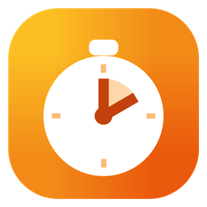

<p align="center">
  
</p>

<h1 align="center">Temporizador</h1>

<p align="center">
  Temporizadores y alarmas para Windows.<br>
  Hecho en Rust con <a href="https://gpui.rs">GPUI</a> (vía <a href="https://gpui-kit.com">gpui-kit</a>).
</p>

## Qué hace

- **Temporizadores:** elige una duración (`hh:mm:ss`) y un nombre opcional, y pulsa *Iniciar* (o `Enter` en el nombre). Puedes tener varios a la vez y pausar, reiniciar, sumar un minuto o quitar cada uno.
- **Predefinidos:** un clic arranca un temporizador (1, 3, 5, 10, 15 min, Pomodoro, 30 min y 1 h). *Guardar como predefinido* agrega la duración y el nombre del formulario. Para borrar uno, pasa el mouse por encima y pulsa la ✕.
- **Alarmas a una hora:** hora, nombre y días en que se repite (L M X J V S D, *L–V*, *Todos*). Sin días suena una sola vez y después se apaga sola. Cada alarma se enciende o se apaga con su interruptor.
- **Cuando algo suena:** se reproduce el sonido en bucle, aparece una notificación de Windows con *Detener* y *Posponer* / *+1 min*, y la ventana se trae al frente con el aviso arriba. `Esc` detiene todo lo que suena.
- **Sigue en la bandeja:** cerrar la ventana la esconde junto al reloj, y los avisos siguen funcionando. Clic en el ícono para volver a abrirla; *Salir* en su menú la cierra del todo.
- **Sobrevive a reinicios:** los temporizadores guardan su hora de fin. Si la app estuvo cerrada cuando uno terminó, suena al abrirla. Una alarma que se perdió hace más de una hora no suena a destiempo; se pasa al próximo día que le toca.
- Abrir la app otra vez muestra la que ya está abierta, en lugar de duplicarla.

## Ajustes

- **Sonido:** los de alarma y timbre de Windows o un pitido propio. Las flechas los recorren y cada uno se escucha al elegirlo.
- **Suena durante:** después se calla solo, pero el aviso queda hasta que lo detengas.
- **Posponer alarmas:** 1, 5, 10 o 15 min.
- Traer al frente al sonar, seguir en la bandeja al cerrar, iniciar con Windows (arranca escondida), siempre encima y tema claro u oscuro.

Todo se guarda en `%APPDATA%\Temporizador` (`settings.json` y `state.json`). En `settings.json`, `"sound"` también acepta la ruta completa de un `.wav` propio.

## Atajos

| Atajo | Acción | Atajo | Acción |
| --- | --- | --- | --- |
| `Ctrl+1` | Temporizadores | `Esc` | Detener lo que suena |
| `Ctrl+2` | Alarmas | `Ctrl+T` | Claro / oscuro |
| `Ctrl+3` `Ctrl+,` | Ajustes | `Ctrl+Shift+T` | Siempre encima |
| `Ctrl+W` | Esconder en la bandeja | `Ctrl+Q` | Salir |

## Compilar

Necesitas Rust (MSVC) y Visual Studio Build Tools con "Desarrollo para el escritorio con C++".

```bash
cargo build --release
```

El ejecutable queda en `target\release\temporizador.exe`. Para instalarla, ejecuta `./install.ps1`: la copia a `%LOCALAPPDATA%\Programs\Temporizador`, crea el acceso del menú Inicio y la abre.

El ícono se genera con `python assets/make_icon.py` (requiere Pillow).
